# Lagos Rent Platform

## Production-Grade Microservices Architecture

A trust-first, Lagos-first rental marketplace for verified listings, transparent pricing, auditable rentals, safe payments, and deliberate Spring Cloud and DevOps learning.

| Architecture pillar | Direction |
|---|---|
| **Spring Cloud platform** | Config Server, Eureka, and API Gateway are first-class learning components. |
| **Distributed business workflows** | RabbitMQ, transactional outbox, idempotent consumers, and a Rental-owned saga. |
| **Operable by design** | Keycloak, database-per-service, OpenTelemetry, Docker, CI/CD, and Kubernetes later. |

> **Document note:** This is the Markdown edition of the architecture PDF. Visual architecture views have been represented as Mermaid diagrams so they remain editable, reviewable, and renderable in compatible Markdown tools.

---

## Contents

1. [Executive summary](#1-executive-summary)
2. [Architecture drivers](#2-architecture-drivers)
3. [Product scope and trust model](#3-product-scope-and-trust-model)
4. [C4 system context](#4-c4-system-context)
5. [Target container architecture](#5-target-container-architecture)
6. [Service catalog and ownership](#6-service-catalog-and-ownership)
7. [Config Server and Eureka](#7-config-server-and-eureka)
8. [Security architecture](#8-security-architecture)
9. [Data architecture](#9-data-architecture)
10. [Communication model](#10-communication-model)
11. [Event contracts and reliability](#11-event-contracts-and-reliability)
12. [Listing publication flow](#12-listing-publication-flow)
13. [Rental-payment saga](#13-rental-payment-saga)
14. [Domain invariants](#14-domain-invariants)
15. [Admin architecture](#15-admin-architecture)
16. [Media, documents, and privacy](#16-media-documents-and-privacy)
17. [Resilience and failure handling](#17-resilience-and-failure-handling)
18. [Observability](#18-observability)
19. [Local deployment](#19-local-deployment)
20. [CI/CD architecture](#20-cicd-architecture)
21. [Kubernetes architecture](#21-kubernetes-architecture)
22. [Repository strategy](#22-repository-strategy)
23. [Implementation sequence](#23-implementation-sequence)
24. [Guardrails and definition of done](#24-guardrails-and-definition-of-done)
25. [Risks and tradeoffs](#25-risks-and-tradeoffs)
26. [Architecture decision record index](#26-architecture-decision-record-index)
27. [References](#27-references)

---

# 1. Executive summary

The platform is a Lagos-first rental marketplace whose differentiator is **trust**: verified authority to list, explicit fees, admin review, immutable price snapshots, backend-verified payments, and auditable operations.

## Business architecture

- Tenants discover approved listings and see the total move-in cost before applying.
- Landlords create properties and rental units, then submit listings for review.
- Admins verify accounts, approve listings and fees, monitor workflows, and resolve reports.
- Rental and payment state are coordinated through an explicit saga rather than a distributed transaction.

## Technical architecture

- Nine Spring Boot deployables: Config Server, Eureka, API Gateway, and six domain services.
- Keycloak for identity and OAuth2/OIDC; RabbitMQ for events and workflow commands.
- Database-per-service with PostgreSQL; MinIO/S3-compatible storage for public media and private documents.
- Transactional outbox and idempotent inbox patterns for reliable messaging.
- OpenTelemetry-based observability.
- Docker Compose first; Kubernetes after the end-to-end workflow is stable.

> **Primary architectural choice:** Config Server and Eureka remain in the application because the project is deliberately optimized for learning Spring Cloud and DevOps. They are intentional dependencies whose behavior, failure modes, and overlap with Kubernetes are part of the curriculum.

## Recommended deployables

1. `config-server`
2. `discovery-server`
3. `api-gateway`
4. `account-service`
5. `listing-service`
6. `search-service`
7. `rental-service`
8. `payment-service`
9. `notification-service`

## Definition of architectural success

The architecture succeeds when every service:

- can be built and deployed independently;
- owns its database and state transitions;
- publishes reliable, versioned events;
- tolerates duplicate delivery and out-of-order messages;
- exposes observable workflow state;
- recovers after dependency outages; and
- completes the rental-payment journey without shared tables or distributed two-phase commit.

---

# 2. Architecture drivers

## Why the system is shaped this way

| Driver | Architectural implication |
|---|---|
| **Trust** | Verification status, document review, clear badges, reporting, and admin auditability are core domain concerns. |
| **Price integrity** | Fee lines and total move-in cost are calculated on the backend and versioned. Rental applications capture immutable price snapshots. |
| **Learning depth** | The project intentionally includes Spring Cloud Config, Eureka, messaging, observability, CI/CD, and orchestration. |
| **Independent ownership** | Every service owns its data and state transitions. No service reaches into another service's database or repository. |
| **Recoverability** | Outbox/inbox, dead-letter queues, reconciliation, saga compensation, and explicit manual review prevent silent corruption. |
| **Operability** | Traces, metrics, structured logs, health probes, deployment evidence, and runbooks are deliverables rather than afterthoughts. |

## Quality attribute priorities

| Attribute | Architectural response | Verification method |
|---|---|---|
| **Security** | Keycloak, token validation in both Gateway and services, private object storage, least privilege, audited admin actions | Authorization tests, threat model, secret scans, access-log review |
| **Consistency** | Single-service transactions, outbox/inbox, aggregate versions, saga state, immutable snapshots | Duplicate/out-of-order tests, crash tests, concurrency tests |
| **Availability** | Timeouts, circuit breakers, cached Eureka registry, durable queues, graceful shutdown, rolling deployment | Dependency outage and restart exercises |
| **Scalability** | Independently scalable services, read projections, stateless application instances, asynchronous processing | Load tests and queue/backlog metrics |
| **Maintainability** | Bounded contexts, versioned contracts, ADRs, monorepo with independent builds, no shared domain library | Architecture review and module dependency checks |
| **Observability** | OpenTelemetry context across HTTP and AMQP, structured logs, dashboards, trace-linked saga state | Trace a complete listing and payment journey |

---

# 3. Product scope and trust model

## Trust-first, Lagos-first, expansion-ready

The first release focuses on one geography and one provider while keeping state, location, and provider abstractions explicit enough for future expansion.

| Actor | Promise |
|---|---|
| **Tenant** | Real listings, clear prices, explicit fees, visible verification levels, protected payment, and no surprise charges after application. |
| **Landlord** | A direct route to serious tenants, structured listing management, inspection/application workflows, and reliable payment records. |
| **Platform** | Review listings, enforce transparent pricing, record authoritative payment state, support reports, and maintain an audit trail. |
| **Admin** | Resolve verification and listing queues, suspend suspicious entities, inspect saga/payment state, and justify every privileged action. |

## Initial functional scope

| Tenant | Landlord | Admin |
|---|---|---|
| Profile, search, listing details, fee breakdown, saved listings, inspection request, application, payment, receipt, report | Profile and verification, property/unit creation, media, fee lines, review submission, inspection decisions, application decisions, payment status | Verification queues, listing review, user suspension, report/dispute handling, payment review, refunds, metrics, audit logs |

> **Scope discipline:** The first complete workflow does not include a multi-state rollout, active multi-provider payment strategy, internal wallet, native mobile app, advanced chat, AI valuation, service mesh, or OpenSearch.

---

# 4. C4 system context

## People and external systems

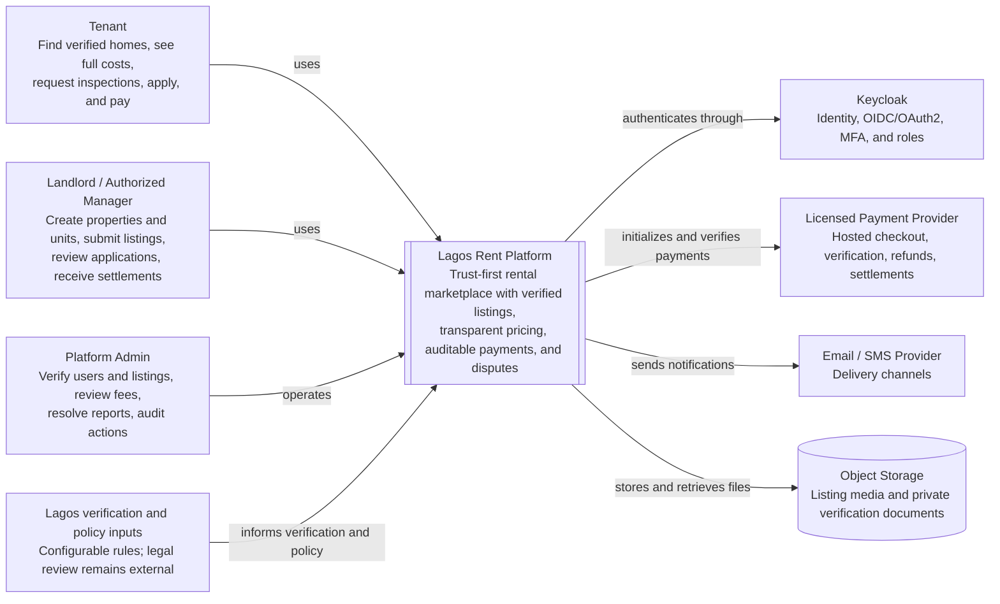

The platform sits between tenants, landlords or authorized managers, admins, identity, payment, communications, object storage, and configurable Lagos-specific verification and policy inputs.

---

# 5. Target container architecture

## Runtime components and primary connections

```mermaid
flowchart TB
    subgraph Clients[Client applications]
        TenantPortal[Tenant Portal]
        LandlordPortal[Landlord Portal]
        AdminDashboard[Admin Dashboard]
    end

    subgraph ControlPlane[Spring Cloud control plane]
        ConfigServer[Config Server<br/>Git-backed external configuration]
        Eureka[Eureka<br/>Registration and discovery]
        Gateway[API Gateway<br/>JWT validation, routing, rate limits,<br/>correlation IDs; no business logic]
    end

    Keycloak[Keycloak<br/>OIDC/OAuth2, roles, MFA, service clients]

    subgraph Services[Business microservices - each owns its data and invariants]
        Account[Account Service<br/>Profiles, verification, suspension]
        Listing[Listing Service<br/>Properties, units, pricing, approval, availability]
        Search[Search Service<br/>Event-built public listing projection]
        Rental[Rental Service<br/>Inspections, applications, reservations, saga]
        Payment[Payment Service<br/>Payables, webhooks, reconciliation, receipts]
        Notification[Notification Service<br/>Templates, delivery records, retries]
    end

    Rabbit[(RabbitMQ<br/>Versioned events and workflow commands<br/>Outbox, inbox, bounded retries, DLQs)]

    subgraph Persistence[Owned persistence]
        AccountDB[(account_db)]
        ListingDB[(listing_db)]
        SearchDB[(search_db)]
        RentalDB[(rental_db)]
        PaymentDB[(payment_db)]
        NotificationDB[(notification_db)]
    end

    Storage[(MinIO / S3<br/>Public listing media and private evidence)]
    Providers[External providers<br/>Hosted payments, email, and SMS]

    subgraph Observability[Observability platform]
        OTel[OpenTelemetry Collector]
        Metrics[Prometheus + Grafana]
        Traces[Tempo / Jaeger]
        Logs[Loki or log platform]
    end

    TenantPortal -->|HTTPS APIs| Gateway
    LandlordPortal -->|HTTPS APIs| Gateway
    AdminDashboard -->|HTTPS APIs| Gateway

    Gateway -->|token validation| Keycloak
    Gateway --> Account
    Gateway --> Listing
    Gateway --> Search
    Gateway --> Rental
    Gateway --> Payment
    Gateway --> Notification

    ConfigServer -. remote config .-> Gateway
    ConfigServer -. remote config .-> Eureka
    ConfigServer -. remote config .-> Account
    ConfigServer -. remote config .-> Listing
    ConfigServer -. remote config .-> Search
    ConfigServer -. remote config .-> Rental
    ConfigServer -. remote config .-> Payment
    ConfigServer -. remote config .-> Notification

    Gateway -. register / discover .-> Eureka
    Account -. register / discover .-> Eureka
    Listing -. register / discover .-> Eureka
    Search -. register / discover .-> Eureka
    Rental -. register / discover .-> Eureka
    Payment -. register / discover .-> Eureka
    Notification -. register / discover .-> Eureka

    Account <--> Rabbit
    Listing <--> Rabbit
    Search <--> Rabbit
    Rental <--> Rabbit
    Payment <--> Rabbit
    Notification <--> Rabbit

    Account --> AccountDB
    Listing --> ListingDB
    Search --> SearchDB
    Rental --> RentalDB
    Payment --> PaymentDB
    Notification --> NotificationDB

    Account --> Storage
    Listing --> Storage
    Rental --> Storage
    Payment --> Providers
    Notification --> Providers

    Gateway -. OTLP .-> OTel
    Account -. OTLP .-> OTel
    Listing -. OTLP .-> OTel
    Search -. OTLP .-> OTel
    Rental -. OTLP .-> OTel
    Payment -. OTLP .-> OTel
    Notification -. OTLP .-> OTel
    OTel --> Metrics
    OTel --> Traces
    OTel --> Logs
```

**Diagram convention:** Solid lines represent primary application or data flows. Dashed lines represent configuration or discovery relationships. Telemetry is exported through OTLP.

---

# 6. Service catalog and ownership

## Domain services

### Account Service

**Owns:**

- tenant and landlord profiles;
- verification cases;
- account suspension;
- preferences;
- saved listings; and
- settlement references.

**Key events:**

- `landlord.verified.v1`
- `account.suspended.v1`

**Boundary:** Keycloak owns credentials, sessions, tokens, and MFA.

### Listing Service

**Owns:**

- properties;
- rental units;
- listings;
- fee lines;
- media metadata;
- review and publication;
- availability; and
- atomic reservation.

**Key events:**

- `listing.published.v1`
- `listing.reserved.v1`
- `listing.rented.v1`

**Boundary:** It does not own tenant applications or provider payment state.

### Search Service

**Owns:**

- public listing-card projection;
- filters;
- pagination;
- search ranking; and
- location taxonomy.

**Input:** Listing lifecycle events.

**Boundary:** Projection data is never authoritative for availability or price acceptance.

### Rental Service

**Owns:**

- inspections;
- applications;
- landlord decisions;
- price snapshots;
- reservations;
- tenancy; and
- saga state.

**Role:** Orchestrates the reservation-payment-tenancy workflow.

**Boundary:** Listing Service decides availability; Payment Service decides payment truth.

### Payment Service

**Owns:**

- payables;
- payment attempts;
- provider webhooks;
- backend verification;
- refunds;
- settlements;
- reconciliation; and
- receipts.

**Rule:** A provider redirect is never accepted as proof of payment.

**Boundary:** Stores immutable references and snapshots, not foreign domain aggregates.

### Notification Service

**Owns:**

- templates;
- delivery records;
- provider attempts;
- retries; and
- dead-letter handling.

**Input:** Domain events such as listing approval, application acceptance, and payment success.

**Rule:** Delivery failure never rolls back the originating business transaction.

## Platform services

| Component | Responsibilities | Explicit non-responsibilities |
|---|---|---|
| **Config Server** | Serve versioned, non-secret external configuration from Git | Secret store, business rules engine, service registry |
| **Eureka** | Register and discover Spring application instances | Discover databases, brokers, Keycloak, storage, or external providers |
| **API Gateway** | Routing, token validation, rate limits, CORS, correlation, edge policy | Domain validation, orchestration, aggregate ownership |
| **Keycloak** | Identity, OAuth2/OIDC, credentials, sessions, roles, service clients | Landlord verification, listing approval, account business profile |

---

# 7. Config Server and Eureka

## Config-first bootstrap without a startup cycle

Every service knows the Config Server bootstrap address directly. After its environment is built, the service registers with Eureka.

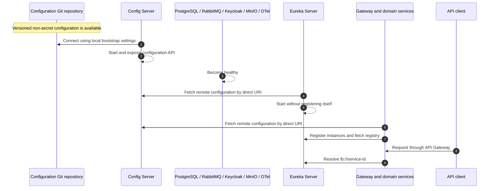

The Config Server itself uses local bootstrap configuration for its Git backend. Discovery-first Config Server lookup can be explored later, after the direct flow is stable.

## Minimal Config Client bootstrap

```yaml
spring:
  application:
    name: listing-service
  config:
    import: configserver:${CONFIG_SERVER_URL:http://localhost:8888}
```

Mandatory remote configuration should fail startup clearly. The optional import form should be reserved for isolated tests or a deliberate standalone developer mode.

## Single-node Eureka server

```yaml
eureka:
  client:
    register-with-eureka: false
    fetch-registry: false
```

Gateway and domain services register with Eureka. Config Server may register after startup for visibility, but clients initially locate it directly.

## Configuration repository policy

| Store in configuration Git | Inject at runtime |
|---|---|
| Ports, timeouts, feature flags, queue names, upload limits, reservation duration, log levels, observability sampling | Database passwords, Keycloak client secrets, payment keys, SMTP credentials, RabbitMQ credentials, cloud credentials, signing keys |

## Spring Cloud Bus extension

RabbitMQ may later distribute selected configuration refresh events through Spring Cloud Bus. Structural settings and secrets should normally change through controlled restarts or rolling deployments rather than arbitrary runtime refresh.

---

# 8. Security architecture

## Identity at the edge and authorization in every service

### End-user flow

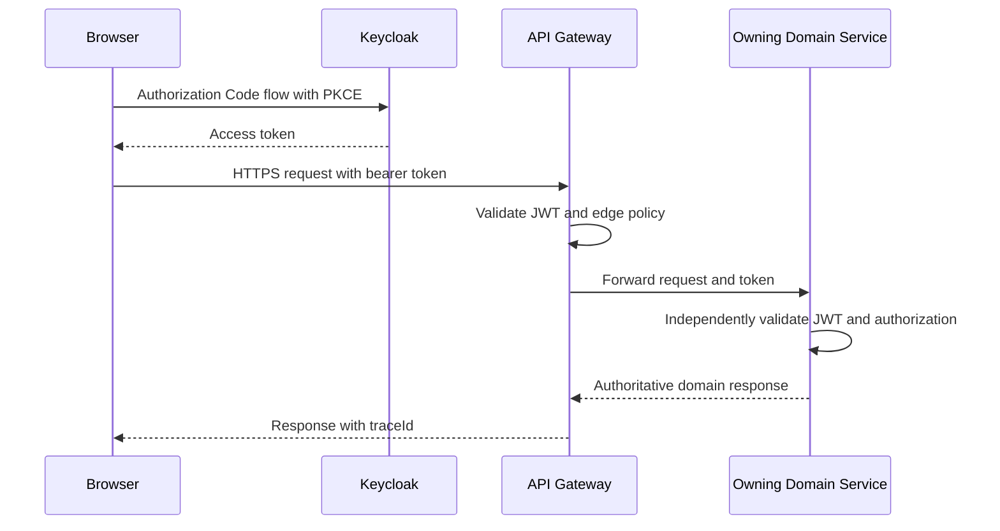

### Internal service flow

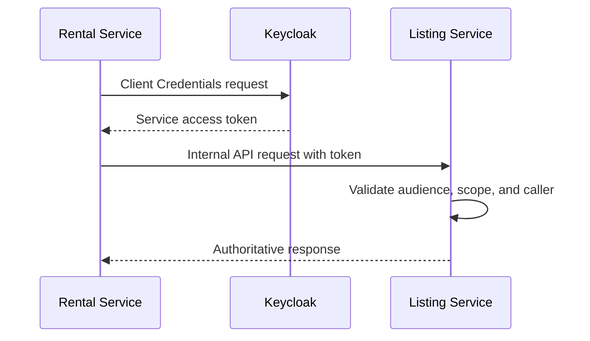

## Roles

- `TENANT`
- `LANDLORD`
- `ADMIN`
- `SUPER_ADMIN`

Roles are identity claims. Domain ownership, account status, and verification status are still checked by the owning service.

## Token validation

Validate all of the following in the API Gateway and downstream services:

- issuer;
- signature;
- expiry;
- audience;
- scopes; and
- roles.

## Header hygiene

The Gateway strips externally supplied identity or internal headers, including examples such as:

- `X-User-Id`
- `X-Internal-Service`

## Authorization examples

| Action | Required checks |
|---|---|
| **Create listing** | `LANDLORD` role, active Account, verified landlord state, ownership of Property/RentalUnit |
| **Approve listing** | `ADMIN` scope, review still open, optimistic concurrency, required reason and audit record |
| **Apply for listing** | `TENANT` role, active account, listing published, no conflicting active application |
| **Initialize payment** | Tenant owns accepted application, reservation confirmed, payable active, amount loaded from server snapshot |
| **Refund** | Privileged payment scope, idempotency key, review state, reason, immutable audit record |

---

# 9. Data architecture

## Database-per-service and explicit data movement

| Service | Database | Core aggregates | Important constraints |
|---|---|---|---|
| **Account** | `account_db` | Account, Profiles, VerificationCase, SavedListing | Unique Keycloak subject; audited verification transitions |
| **Listing** | `listing_db` | Property, RentalUnit, Listing, Fee, Review, Reservation | Atomic reserve condition; listing version increases on material change |
| **Search** | `search_db` | ListingProjection, LocationTaxonomy | Unique listing ID; last aggregate version prevents stale updates |
| **Rental** | `rental_db` | Inspection, Application, PriceSnapshot, Reservation, Tenancy, Saga | Immutable accepted price snapshot; one active reservation path per application |
| **Payment** | `payment_db` | Payable, Attempt, Transaction, Webhook, Refund, Receipt | Unique provider/internal references; idempotent webhook processing |
| **Notification** | `notification_db` | Template, Delivery, ProviderAttempt | Unique event/template/recipient key prevents duplicates |

> **Forbidden:** Cross-service foreign keys, shared repositories, reporting joins across operational databases, and direct admin database edits.

## Read-model strategy

Search Service consumes listing events and builds a public projection. PostgreSQL is sufficient for the first version. OpenSearch should be introduced only when ranking, typo tolerance, scale, or operational independence justify it.

## Object-storage strategy

| Bucket or class | Content | Access model |
|---|---|---|
| **Public listing media** | Approved listing photos and optimized derivatives | CDN or public read after moderation; uploads through signed URLs |
| **Private verification documents** | Identity, authority, and property documents | Private; short-lived signed URLs; access logged |
| **Private receipts and agreements** | Generated or uploaded tenant documents | Authorized parties only; retention policy enforced |

---

# 10. Communication model

## HTTP for immediate authority; RabbitMQ for durable coordination

| Synchronous HTTP | Asynchronous RabbitMQ |
|---|---|
| Use when the caller requires an immediate authoritative answer or a user-facing command result. | Use for completed domain facts, durable workflow commands, projections, notifications, and compensation. |
| Gateway to the owning service | Listing lifecycle events to Search |
| Rental obtains current listing and price data before snapshotting | Reservation commands and events across Rental and Listing |
| Payment verifies a transaction with the provider | Payment results to Rental |
| Admin executes a privileged command on the state owner | Business events to Notification |
| Requires timeout, authentication, correlation, and explicit failure mapping | Requires versioned schema, outbox, publisher confirms, idempotent consumer, and DLQ |

## API conventions

```text
Public:   /api/v1/{domain}/...
Admin:    /api/v1/admin/{domain}/...
Internal: /internal/v1/{domain}/...
```

Every response and error includes a `traceId`. Mutating operations that can safely be retried accept an `Idempotency-Key` where appropriate.

---

# 11. Event contracts and reliability

## Common event envelope

```json
{
  "eventId": "34d86bc5-3945-41ce-8d51-0ba9460db558",
  "eventType": "listing.published.v1",
  "aggregateType": "listing",
  "aggregateId": "fa3f3a60-5a84-4514-8731-12db97eff937",
  "aggregateVersion": 8,
  "occurredAt": "2026-08-13T16:30:00Z",
  "producer": "listing-service",
  "correlationId": "b07a9bf1-6e49-45cb-a15f-6eb9da83247b",
  "causationId": "75082d46-d726-4365-a063-357c7d30410c",
  "payload": {}
}
```

## Transactional outbox publication

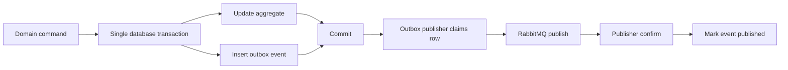

Start with polling. Debezium CDC is a later learning extension.

## Idempotent inbox consumption

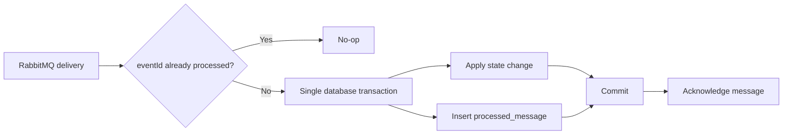

Assume **at-least-once delivery and safe repetition**, never exactly-once delivery.

## RabbitMQ topology

| Element | Convention | Operational rule |
|---|---|---|
| **Exchange** | `platform.domain.v1` | Durable; route by versioned domain key |
| **Routing key** | `<domain>.<event-name>.v1` | Represents a fact or an explicit workflow command |
| **Queue** | `<consumer>.<purpose>.v1` | One logical responsibility per queue |
| **Retry** | Bounded delay queues | No infinite requeue loop |
| **DLQ** | `<queue>.dlq` | Alert, inspect, and replay through controlled tooling |

---

# 12. Listing publication flow

## First distributed vertical slice: listing publication to search projection

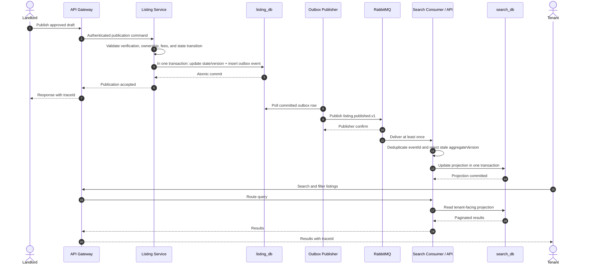

Search does not synchronously call Listing Service for the tenant's ordinary search request. Search data is a tenant-facing read model, not the source of truth for price acceptance or availability.

## First milestone proof

This vertical slice proves:

- authentication;
- Config Server integration;
- Eureka registration and discovery;
- Gateway routing;
- database ownership;
- transactional outbox publishing;
- RabbitMQ delivery;
- idempotent projection updates; and
- tenant search through one distributed trace.

---

# 13. Rental-payment saga

## Distributed workflow and compensation

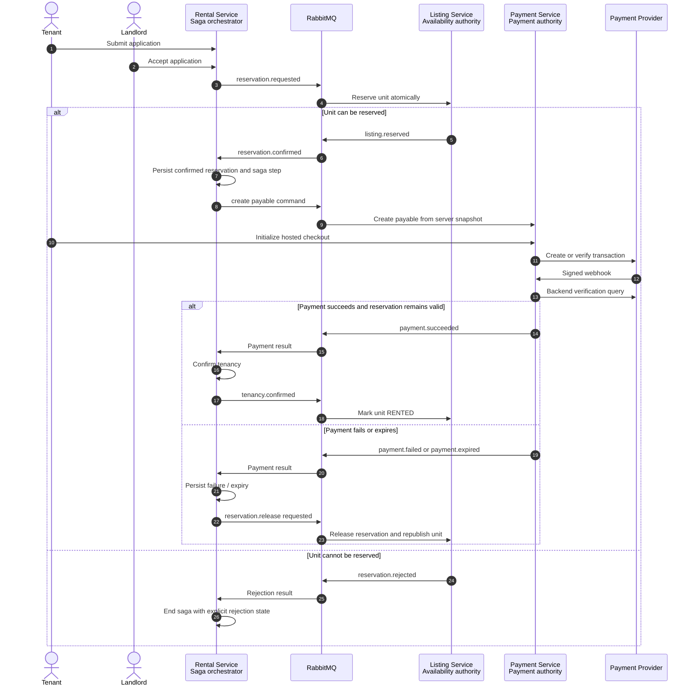

Rental Service orchestrates workflow state. Listing Service owns availability. Payment Service owns provider truth. Failures trigger explicit compensation or manual review.

## Late or ambiguous payment

A payment that succeeds after reservation expiry does not silently complete the rental. The saga moves to a `REVIEW_REQUIRED` or equivalent manual-review state, and Payment Service performs provider reconciliation.

---

# 14. Domain invariants

## Trust and price-integrity rules

1. A listing cannot be submitted without a complete backend-calculated price breakdown.
2. A listing cannot be published without landlord verification and admin approval.
3. Every fee records its type, amount, recipient, frequency, refundability, and explanation.
4. An `OTHER` fee requires explicit admin approval.
5. The exact property address remains private until the approved workflow stage.
6. A rental application stores an immutable listing version and price snapshot.
7. Only Listing Service can atomically reserve or release a unit.
8. No rent payment begins before an accepted application and confirmed reservation.
9. Payment amount and currency must match the server-side payable.
10. Provider redirects do not mark payments successful; a signed webhook plus backend verification is required.
11. Duplicate webhooks and events produce one effective transition.
12. A late payment after reservation expiry enters explicit review; it is not silently accepted or ignored.
13. Every privileged admin mutation requires a reason and an immutable audit record.

## Listing state machine

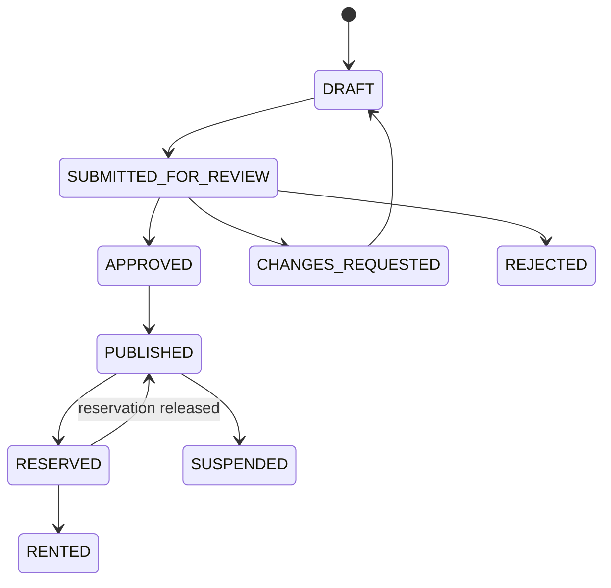

## Application and reservation state machine

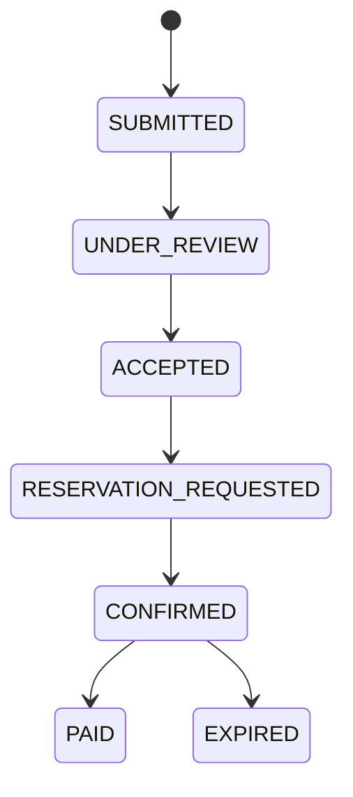

## Payment state machine

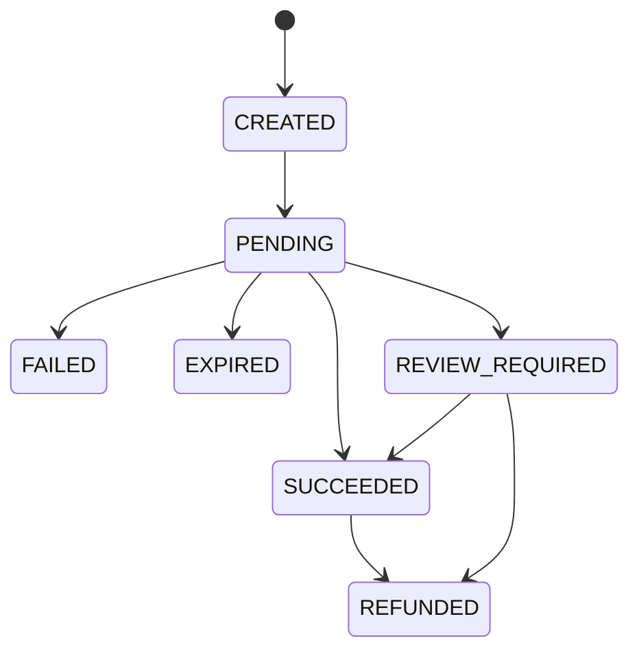

---

# 15. Admin architecture

## A privileged client, not a catch-all database service

The Admin Dashboard routes each operation to the service that owns the state. This preserves bounded contexts and prevents a central admin service from becoming a shared-database backdoor.

| Admin capability | Owning API | Required audit detail |
|---|---|---|
| Landlord verification and account suspension | Account Service | Actor, decision, reason, prior and new status, document references |
| Listing review, fee approval, listing suspension | Listing Service | Listing version, fee changes, reason, reviewer, timestamps |
| Inspection, application, and reservation review | Rental Service | Saga/application state, actor, reason, correlation and trace IDs |
| Payment verification, refund, reconciliation | Payment Service | Provider references, idempotency key, amount/currency, evidence, actor |
| Delivery failures and replay | Notification Service | Event ID, template, provider attempt, replay actor |

## Cross-service dashboards

For the MVP, the UI may compose a small number of owner API calls. When reporting volume grows, introduce an event-built Analytics or Reporting Service rather than querying every operational database.

> **Administrative safety:** Destructive actions require role or scope checks, a reason, optimistic concurrency, and an immutable audit record. Sensitive exports require separate authorization and PII review.

---

# 16. Media, documents, and privacy

## Separate public listing data from sensitive evidence

| Public listing surface | Private surface |
|---|---|
| Area, LGA, approximate location, and landmark | Exact address before the approved inspection stage |
| Approved photos and amenities | Identity and authority documents |
| Rent, fee lines, and total move-in cost | Bank or settlement references and provider metadata |
| Verification badges with clear meaning | Complaint evidence and sensitive audit context |

## Required controls

- Private buckets and short-lived signed URLs.
- Malware and content-scanning extension point for uploads.
- Access logs for sensitive documents.
- PII minimization in events, logs, and traces.
- Retention and deletion policies by data class.
- Encryption in transit and at rest.
- Tightly scoped service credentials.

Legal and regulatory rules should be represented as configurable policy and reviewed by qualified professionals before public launch. The architecture preserves the records needed for receipts, decisions, disputes, and audit without claiming to replace legal review.

---

# 17. Resilience and failure handling

## Failure is a normal operating mode

| Failure | Expected behavior | Mechanism |
|---|---|---|
| Config Server unavailable during a new startup | Mandatory clients fail clearly; existing healthy instances continue | Config-first bootstrap, probes, controlled rolling changes |
| Eureka temporarily unavailable | Clients use cached registry while attempting reconnection | Client registry cache, sensible timeouts, multiple peers later |
| RabbitMQ unavailable during a business commit | Business transaction commits; event remains in outbox | Transactional outbox and retrying publisher |
| Consumer receives duplicate | One effective state change | Inbox or processed-message key and idempotent handler |
| Events arrive out of order | Older aggregate version is ignored or reconciled | Aggregate version in envelope and projection |
| Payment webhook duplicated | One transaction transition and one receipt | Unique provider reference and webhook idempotency |
| Payment succeeds after reservation expiry | Explicit review and reconciliation | Saga manual-review state and provider query |
| Notification provider unavailable | Business transaction remains complete; delivery retries or moves to DLQ | Asynchronous Notification Service |

## Retry policy

**Safe candidates:**

- read-only `GET` requests;
- provider verification queries;
- idempotent commands with an idempotency key; and
- temporary connection failures before side effects.

**Unsafe by default:**

- create payment;
- refund;
- accept application;
- reserve listing; and
- authorization or validation failures.

## Operational recovery artifacts

Maintain runbooks for:

- DLQ replay;
- stuck saga resolution;
- outbox backlog;
- pending payment reconciliation;
- failed configuration rollout;
- database restore; and
- controlled service rollback or forward-fix.

---

# 18. Observability

## One trace across HTTP, RabbitMQ, and provider calls

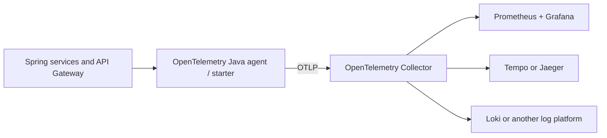

## Telemetry requirements

| Signal | Required fields or measurements |
|---|---|
| **Logs** | service, environment, `traceId`, `spanId`, `correlationId`, route, status, duration, event type, permitted actor context |
| **Metrics** | latency, errors, queue depth, DLQ count, outbox age, projection lag, saga duration, pending-payment age, webhook failures |
| **Traces** | W3C context propagated through Gateway, HTTP clients, AMQP headers, consumers, and payment-verification calls |

## Priority dashboards and alerts

| Dashboard or alert | Why it matters |
|---|---|
| Listing event time versus Search projection update time | Measures actual eventual-consistency lag |
| Oldest unpublished outbox event | Detects broken event publication before data drifts |
| DLQ growth and consumer failures | Shows poison messages and contract or processing failures |
| Stuck saga and reservation age | Prevents units remaining locked indefinitely |
| Pending payment and reconciliation age | Detects provider/webhook disagreement and customer-impacting uncertainty |
| Eureka registrations and Config request failures | Shows control-plane degradation |

---

# 19. Local deployment

## Docker Compose learning environment

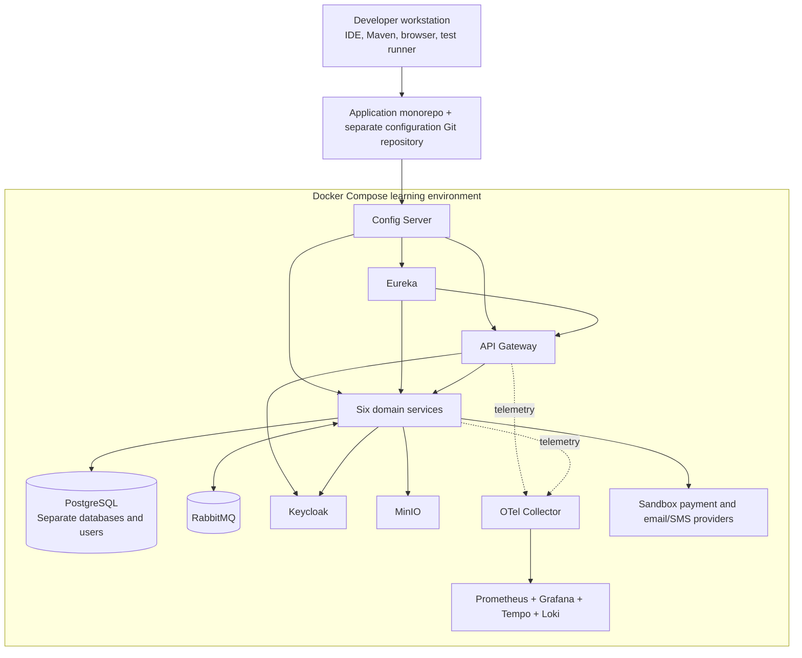

One command should start a repeatable environment with:

- health checks;
- named volumes;
- separate databases and users;
- sandbox providers; and
- the complete observability path.

---

# 20. CI/CD architecture

## Pipeline and promotion flow

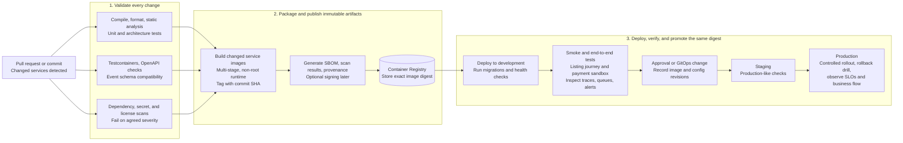

Build immutable images, scan them, deploy exact digests, execute smoke and end-to-end tests, and promote the same artifact through environments. Environment configuration remains external.

---

# 21. Kubernetes architecture

## Orchestration after the end-to-end workflow works

Cluster components include:

- Ingress or Gateway API;
- API Gateway;
- Config Server;
- Eureka;
- domain deployments;
- Kubernetes Services;
- OpenTelemetry Collector;
- Prometheus and Grafana;
- Kubernetes Secrets; and
- NetworkPolicies.

## Two intentional discovery profiles

| Profile | Behavior | Learning objective |
|---|---|---|
| **`kubernetes-eureka`** | Applications register with Eureka; Gateway resolves `lb://service-id`; Kubernetes Services still provide stable networking | Operate the Spring Cloud design in a cluster and observe overlap and failure behavior |
| **`kubernetes-native`** | Eureka clients are disabled; applications use Kubernetes Services and DNS | Compare application-level registry discovery with platform-native discovery |

## Deployment requirements

- Readiness, liveness, and startup probes.
- Graceful shutdown and rolling-update tests.
- Resource requests and limits.
- NetworkPolicies.
- PodDisruptionBudgets where justified.
- Autoscaling only where supported by evidence.
- Helm or Kustomize with environment-specific values.
- Immutable image digests.
- Managed PostgreSQL and object storage for realistic production-like environments.
- A supported RabbitMQ deployment.
- GitOps with Argo CD or Flux as a later DevOps learning phase.

---

# 22. Repository strategy

## Monorepo for application code; separate repository for configuration

### Application monorepo

```text
lagos-rent-platform/
├── services/
│   ├── config-server/
│   ├── discovery-server/
│   ├── api-gateway/
│   ├── account-service/
│   ├── listing-service/
│   ├── search-service/
│   ├── rental-service/
│   ├── payment-service/
│   └── notification-service/
├── frontend/
│   └── web-application/
├── contracts/
│   ├── openapi/
│   ├── asyncapi/
│   └── event-schemas/
├── platform/
│   ├── docker-compose/
│   ├── keycloak/
│   ├── rabbitmq/
│   ├── observability/
│   ├── kubernetes/
│   └── helm/
├── docs/
│   ├── architecture/
│   ├── adr/
│   ├── diagrams/
│   └── runbooks/
├── .github/
│   └── workflows/
└── pom.xml
```

### Configuration repository

```text
lagos-rent-config/
├── application.yml
├── application-local.yml
├── application-docker.yml
├── application-staging.yml
├── application-production.yml
├── discovery-server.yml
├── api-gateway.yml
├── account-service.yml
├── listing-service.yml
├── search-service.yml
├── rental-service.yml
├── payment-service.yml
└── notification-service.yml
```

> **No shared domain library:** The root Maven build may manage versions and quality plugins, but must not distribute JPA entities, domain DTOs, repositories, validation rules, or payment/listing models across services.

---

# 23. Implementation sequence

Build complete vertical slices in dependency order.

| Order | Phase | Required proof before continuing |
|---:|---|---|
| 1 | Architecture, ADRs, state machines, service ownership | Every state and transition has one owner |
| 2 | Monorepo, compatible Spring BOM, CI build | Clean checkout passes `mvn verify` |
| 3 | Configuration repository and Config Server | Remote profile/property retrieval works and failure behavior is clear |
| 4 | Eureka and bootstrap sequence | Sample service registers and discovers without circular dependency |
| 5 | Docker Compose platform, Keycloak, and Gateway | Authenticated Gateway route reaches a discovered health endpoint |
| 6 | Service template and Account Service | Profiles and verification work with security, migrations, and tests |
| 7 | Listing Service and transparent pricing | Admin-approved listing contains immutable versioned fee data |
| 8 | RabbitMQ contracts, outbox/inbox, and Search | Listing projection recovers from broker and Search outages |
| 9 | Rental Service and price snapshots | Inspection and application flow stores an immutable snapshot |
| 10 | Payment Service and provider sandbox | Signed webhook plus backend verification; duplicate-safe processing |
| 11 | Rental-payment saga and compensation | No double reservation; failure or expiry releases the unit |
| 12 | Notification and admin operations | Asynchronous retries/DLQ and fully audited privileged actions |
| 13 | Resilience, observability, and complete test suite | Failure scenarios recover without manual data repair |
| 14 | CI/CD, registry, and deployment evidence | Exact commit, image digest, and config revision are traceable |
| 15 | Kubernetes, Helm/GitOps comparison, and hardening | Rolling deployment preserves the complete user journey |

> **First milestone:** A landlord publishes a minimal listing, Listing Service writes an outbox event, RabbitMQ delivers it, Search Service stores an independent projection, and a tenant retrieves it through the Gateway with one distributed trace.

The companion implementation guide expands this sequence into detailed phases, tasks, tests, and exit criteria.

---

# 24. Guardrails and definition of done

## Architectural guardrails

1. No shared database or JPA entity.
2. No business logic in API Gateway.
3. No distributed transaction manager.
4. Every event is versioned and published through the outbox.
5. Every consumer is idempotent.
6. Every synchronous dependency has a timeout.
7. Search remains a projection.
8. Payment proof comes from backend verification.
9. Admin mutations are audited.
10. Secrets remain outside configuration Git.

## Distributed MVP definition of done

- Services independently build and deploy.
- Broker outage does not lose committed events.
- Duplicate and out-of-order events are tolerated.
- Reservation uses an observable saga.
- Compensation releases failed reservations.
- One trace crosses HTTP and RabbitMQ boundaries.
- Stuck sagas, DLQs, outbox backlog, and pending payments are visible.
- A stopped service can later recover.
- Payment webhooks are idempotent and reconciled.
- Backup, restore, and incident runbooks exist.

## Mandatory failure tests

- RabbitMQ outage.
- Search Service offline.
- Duplicate event.
- Out-of-order event.
- Consumer crash after database commit.
- Publisher crash after broker send.
- Duplicate payment webhook.
- Late webhook.
- Notification provider failure.
- Config Server restart.
- Eureka restart.

---

# 25. Risks and tradeoffs

| Risk or tradeoff | Impact | Mitigation |
|---|---|---|
| Nine Spring applications plus infrastructure | High local and cognitive overhead | Vertical slices, monorepo, standard templates, Compose profiles, strong documentation |
| Config Server and Eureka startup dependency | Control-plane outage can block new instances | Direct config bootstrap, health checks, cached registry, peer Eureka later, controlled rollout |
| Eventual consistency | Search and admin screens can lag | Projection-lag metrics, user-visible states, rebuild tooling, aggregate versions |
| Saga complexity | Partial failure and ambiguous states | Persisted saga steps, compensation, deadlines, manual review, trace-linked admin view |
| Payment and regulatory exposure | Trust, compliance, and financial-loss risk | Licensed provider, hosted checkout, no self-operated wallet or escrow, reconciliation, legal review |
| Sensitive documents | Privacy and fraud risk | Private storage, signed URLs, access logs, least privilege, retention rules |
| Eureka overlaps with Kubernetes discovery | Duplicate mechanisms and operational cost | Treat Eureka as a documented learning profile and compare with Kubernetes-native discovery later |

---

# 26. Architecture decision record index

Recommended ADRs:

1. Lagos-only MVP.
2. Transparent fee lines and total move-in cost.
3. Keycloak as identity provider.
4. Initial microservice boundaries.
5. Database-per-service.
6. RabbitMQ for events and workflow commands.
7. Transactional outbox.
8. Inbox and idempotent consumers.
9. Rental Service as saga orchestrator.
10. Search as an event-built projection.
11. Spring Cloud Config Server.
12. Eureka service discovery.
13. Config-first bootstrap.
14. Secrets outside configuration Git.
15. Admin Dashboard calls owning service APIs.
16. Docker Compose before Kubernetes.
17. OpenTelemetry observability.
18. One payment provider behind an adapter.

Every ADR should contain:

- context;
- decision;
- alternatives considered;
- consequences;
- status; and
- review trigger.

---

# 27. References

## Official technical references

1. [Spring Cloud release train compatibility](https://spring.io/projects/spring-cloud)
2. [Spring Cloud Config Client and Config Data import](https://docs.spring.io/spring-cloud-config/reference/client.html)
3. [Spring Cloud Netflix and Eureka](https://docs.spring.io/spring-cloud-netflix/reference/spring-cloud-netflix.html)
4. [Spring Cloud Bus quick start](https://docs.spring.io/spring-cloud-bus/reference/quickstart.html)
5. [Keycloak OpenID Connect](https://www.keycloak.org/securing-apps/oidc-layers)
6. [RabbitMQ reliability](https://www.rabbitmq.com/docs/reliability)
7. [RabbitMQ publisher confirms](https://www.rabbitmq.com/docs/confirms)
8. [OpenTelemetry Java instrumentation](https://opentelemetry.io/docs/languages/java/instrumentation/)
9. [Kubernetes Services](https://kubernetes.io/docs/concepts/services-networking/service/)
10. [Kubernetes DNS for Services and Pods](https://kubernetes.io/docs/concepts/services-networking/dns-pod-service/)

## Version baseline from the architecture document

At the document's preparation date, the official Spring compatibility table mapped Spring Cloud `2025.1.x` to Spring Boot `4.0.x` and `4.1.x`, beginning with the relevant service release. Exact compatible patch versions should be pinned through the Spring Cloud BOM and re-checked before upgrades.

---

## Companion document

The separate implementation guide contains the detailed phase-by-phase build order, checklists, exit criteria, test scenarios, and deployment steps that operationalize this architecture.
