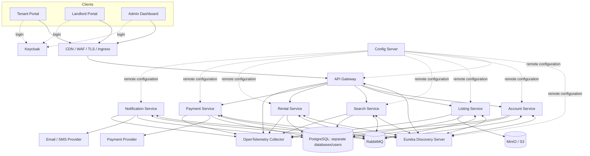

# Lagos Rent Platform - Step-by-Step Microservices Implementation Guide

> A learning-oriented, production-style implementation order for a Lagos-first rental marketplace built with Spring Boot, Spring Cloud Config, Eureka, Keycloak, RabbitMQ, PostgreSQL, Docker, observability tooling, CI/CD, and Kubernetes.

**Document status:** Architecture implementation baseline  
**Last updated:** 2026-08-15  
**Primary goal:** Learn how a real distributed system behaves while building a useful trust-first rental platform.

---

## 1. What you are building

The platform is not merely a property search website. Its core product promise is to reduce rental fraud and price manipulation by enforcing:

- verified landlords or authorized property representatives;
- admin-reviewed listings;
- a complete price breakdown before a tenant applies or pays;
- immutable price snapshots during the rental workflow;
- backend-verified payments;
- auditable admin actions, reports, and disputes;
- clear ownership of data and state transitions across microservices.

The initial scope is Lagos only. The architecture must still use location abstractions that can support additional states later without redesigning every service.

### Core actors

| Actor | Main capabilities |
|---|---|
| Tenant | Search, save listings, request inspections, apply, pay, receive receipts, report problems |
| Landlord | Complete verification, create properties and units, submit listings, review applications, receive payment status |
| Admin | Verify accounts, review listings and fee lines, suspend entities, inspect payments, resolve reports, audit actions |
| Platform | Enforce transparent pricing, reliable workflows, payment verification, traceability, and policy |

### MVP non-goals

Do not put these into the first implementation path:

- multi-state support;
- native mobile applications;
- in-app chat;
- AI rent prediction or recommendation;
- internal wallet or self-operated escrow;
- multiple payment providers active at once;
- event sourcing;
- service mesh;
- OpenSearch before PostgreSQL search is proven insufficient;
- a separate service for every small noun.

---

## 2. Target architecture

### Spring Boot deployables

1. `config-server`
2. `discovery-server`
3. `api-gateway`
4. `account-service`
5. `listing-service`
6. `search-service`
7. `rental-service`
8. `payment-service`
9. `notification-service`

### Supporting platform components

- Keycloak
- RabbitMQ
- PostgreSQL
- MinIO or another S3-compatible object store
- OpenTelemetry Collector
- Prometheus and Grafana
- Tempo or Jaeger
- Loki or another centralized log platform
- one payment provider sandbox
- one email provider and, later, one SMS provider
- a separate Git repository for Spring Cloud Config data

### Architecture overview



---

## 3. Non-negotiable architecture rules

Keep these rules in `docs/architecture/guardrails.md` and enforce them during review.

1. No shared business database.
2. No shared JPA entity or repository across services.
3. No service may query another service's tables.
4. The API Gateway contains no domain logic.
5. Each service owns its state transitions.
6. Cross-service database transactions are forbidden.
7. Published domain events use a transactional outbox.
8. Message consumers are idempotent and assume at-least-once delivery.
9. Every synchronous call has an explicit timeout.
10. Retries require an idempotency analysis.
11. Search is a projection, not the source of truth.
12. Payment redirects are not proof of payment.
13. Event contracts are versioned.
14. Admin operations use service APIs, never direct database access.
15. Secrets do not belong in the configuration Git repository.
16. Every distributed workflow exposes observable state and correlation IDs.
17. Config Server is reached directly during bootstrap to avoid a Config/Eureka startup cycle.
18. Eureka is for Spring application discovery, not for PostgreSQL, RabbitMQ, Keycloak, MinIO, or external providers.

---

## 4. Service ownership

| Service | Owns | Does not own |
|---|---|---|
| Account Service | Tenant/landlord profiles, verification cases, account suspension, preferences, saved listings, settlement references | Passwords, sessions, listing state, payment transactions |
| Listing Service | Properties, rental units, fee lines, media metadata, listing review, publication, availability, atomic unit reservation | Tenant applications, payment status, search result ranking |
| Search Service | Public listing projection, filtering, pagination, location taxonomy, search-specific indexes | Authoritative listing state or availability decisions |
| Rental Service | Inspections, applications, landlord decisions, price snapshots, reservations, tenancy state, saga orchestration | Listing availability authority, provider payment truth |
| Payment Service | Payables, attempts, transactions, webhooks, refunds, settlements, receipts, reconciliation | Listings, applications, tenant/landlord profiles |
| Notification Service | Templates, deliveries, provider attempts, retry status, notification preferences projection where needed | Original business transaction state |
| Keycloak | Credentials, login sessions, tokens, MFA, identity roles, OIDC clients | Business profile and verification state |

### Database ownership

```text
account-service      -> account_db / account_user
listing-service      -> listing_db / listing_user
search-service       -> search_db / search_user
rental-service       -> rental_db / rental_user
payment-service      -> payment_db / payment_user
notification-service -> notification_db / notification_user
keycloak             -> keycloak_db / keycloak_user
```

One local PostgreSQL container may host these databases, but credentials and ownership must remain separate.

---

## 5. Recommended version discipline

At the time this guide was prepared, a sensible baseline was:

```text
Java 21
Spring Boot 4.1.x
Spring Cloud 2025.1.x
Maven
PostgreSQL
RabbitMQ
Keycloak
Docker / Docker Compose
Kubernetes later
```

Do not choose Spring Boot and Spring Cloud versions independently. Import the matching Spring Cloud release-train BOM, then pin exact patch versions in one root property. Re-check the official compatibility table before the first commit and before major upgrades.

The root parent may manage versions and plugins, but it must not become a shared business-code module.

---

## 6. Repository strategy

Use an application monorepo and a separate configuration repository.

### Application repository

```text
lagos-rent-platform/
├── services/
│   ├── config-server/
│   ├── discovery-server/
│   ├── api-gateway/
│   ├── account-service/
│   ├── listing-service/
│   ├── search-service/
│   ├── rental-service/
│   ├── payment-service/
│   └── notification-service/
├── frontend/
│   └── web-application/
├── contracts/
│   ├── openapi/
│   ├── asyncapi/
│   └── event-schemas/
├── platform/
│   ├── docker-compose/
│   ├── keycloak/
│   ├── rabbitmq/
│   ├── observability/
│   ├── kubernetes/
│   └── helm/
├── docs/
│   ├── architecture/
│   ├── adr/
│   ├── diagrams/
│   └── runbooks/
├── .github/workflows/
└── pom.xml
```

### Configuration repository

```text
lagos-rent-config/
├── application.yml
├── application-local.yml
├── application-docker.yml
├── application-staging.yml
├── application-production.yml
├── discovery-server.yml
├── api-gateway.yml
├── account-service.yml
├── listing-service.yml
├── search-service.yml
├── rental-service.yml
├── payment-service.yml
└── notification-service.yml
```

Store non-secret configuration here: ports, timeouts, feature flags, queue names, log levels, upload limits, reservation durations, provider modes, and observability settings.

Do not store database passwords, Keycloak client secrets, payment keys, SMTP passwords, RabbitMQ credentials, signing keys, or cloud credentials.

---

# Part II - Implementation order

## Phase dependency map


Do not scaffold every domain service and leave them empty. Complete each milestone as a thin vertical slice before expanding the next domain.

---

## Phase 0 - Freeze the architecture decisions

### Objective

Turn assumptions into explicit, reviewable decisions before coding.

### Work items

- [ ] Write the product problem statement and MVP scope.
- [ ] Define the tenant, landlord, and admin journeys.
- [ ] Create a service ownership table.
- [ ] Define listing, application, reservation, tenancy, and payment state machines.
- [ ] Decide that the Rental Service is the saga orchestrator.
- [ ] Decide that Search is an event-built projection.
- [ ] Decide that Config Server and Eureka are baseline learning components.
- [ ] Decide that Config Server is reached directly during bootstrap.
- [ ] Define what is deliberately out of MVP.
- [ ] Create initial ADRs.

### Initial ADR set

```text
ADR-001 Lagos-only MVP
ADR-002 Transparent fee lines and total move-in cost
ADR-003 Keycloak as identity provider
ADR-004 Microservice boundaries
ADR-005 Database per service
ADR-006 RabbitMQ for domain events and workflow commands
ADR-007 Transactional outbox
ADR-008 Inbox/idempotent consumers
ADR-009 Rental Service as saga orchestrator
ADR-010 Search Service as an event-built projection
ADR-011 Spring Cloud Config Server
ADR-012 Eureka service discovery
ADR-013 Config-first bootstrap to avoid circular startup
ADR-014 Secrets outside configuration Git
ADR-015 Admin dashboard calls owning service APIs
ADR-016 Docker Compose before Kubernetes
ADR-017 OpenTelemetry-based observability
ADR-018 One payment provider behind an adapter
```

### Exit criteria

- A new contributor can answer which service owns each important state.
- No unresolved disagreement remains about Config Server, Eureka, Keycloak, RabbitMQ, database ownership, or saga ownership.

---

## Phase 1 - Create the monorepo and build foundation

### Objective

Create a repeatable build without creating shared business coupling.

### Work items

- [ ] Create the directory structure shown above.
- [ ] Add a root Maven parent/aggregator.
- [ ] Set Java release level and compiler flags.
- [ ] Import the compatible Spring Cloud BOM.
- [ ] Centralize plugin versions for compiler, test, coverage, formatting, and static analysis.
- [ ] Add `.editorconfig`, `.gitignore`, contribution notes, and commit conventions.
- [ ] Add a basic CI workflow that executes `mvn -B verify`.
- [ ] Add one empty smoke-test module only long enough to prove the parent build.

### Root build responsibilities

The root build may manage:

- Java and Spring versions;
- Maven plugin versions;
- test-library versions;
- common compiler and quality rules;
- module aggregation.

It must not provide shared JPA entities, repositories, domain DTOs, or domain validation.

### Exit criteria

```bash
mvn -B verify
```

passes from a clean checkout.

---

## Phase 2 - Create the external configuration repository

### Objective

Separate deploy-time configuration from application binaries.

### Work items

- [ ] Create `lagos-rent-config` as a separate Git repository.
- [ ] Add `application.yml` for truly shared non-secret defaults.
- [ ] Add environment profiles: `local`, `docker`, `staging`, `production`.
- [ ] Add one file per application.
- [ ] Define naming conventions for environment variables.
- [ ] Add a README explaining precedence and secret handling.
- [ ] Protect the production branch and require review for configuration changes.

### Suggested shared configuration

```yaml
management:
  endpoints:
    web:
      exposure:
        include: health,info,prometheus
  endpoint:
    health:
      probes:
        enabled: true

server:
  shutdown: graceful

spring:
  lifecycle:
    timeout-per-shutdown-phase: 20s
```

### Secret pattern

Configuration may refer to environment variables:

```yaml
spring:
  datasource:
    url: ${LISTING_DB_URL}
    username: ${LISTING_DB_USERNAME}
    password: ${LISTING_DB_PASSWORD}
```

The actual values must be injected by the runtime.

### Exit criteria

- The repository contains no secret values.
- Every property has a clear owner and environment scope.

---

## Phase 3 - Implement Config Server

### Objective

Prove that a Spring application can load versioned remote configuration from Git.

### Bootstrap rule

The Config Server cannot depend on itself. Its Git URI, credentials, encryption settings, and server port are local bootstrap configuration or environment variables.

### Work items

- [ ] Generate `config-server`.
- [ ] Enable Spring Cloud Config Server.
- [ ] Configure the Git backend with environment variables.
- [ ] Expose health and info endpoints.
- [ ] Add Dockerfile and health check.
- [ ] Test retrieval for `discovery-server/default` and one profile.
- [ ] Add access controls before any non-local deployment.
- [ ] Add a runbook for Git unavailability and stale configuration.

### Client bootstrap pattern

Every Config Client needs a tiny local file:

```yaml
spring:
  application:
    name: listing-service
  config:
    import: configserver:${CONFIG_SERVER_URL:http://localhost:8888}
```

Removing `optional:` makes startup fail when required configuration cannot be loaded. An optional import may be used only for isolated tests or a deliberately standalone developer mode.

### Exit criteria

- Changing a non-secret property in Git changes the property returned by Config Server.
- A client fails clearly when mandatory configuration is unavailable.

---

## Phase 4 - Implement Eureka Discovery Server

### Objective

Register and discover Spring services through a dedicated registry.

### Work items

- [ ] Generate `discovery-server`.
- [ ] Make it a Config Client using the direct Config Server URL.
- [ ] Enable the Eureka Server.
- [ ] Disable self-registration and registry fetching for the single-node local server.
- [ ] Expose health and metrics.
- [ ] Add Dockerfile and health check.
- [ ] Add a future profile for a peer-aware multi-node Eureka exercise.

### Local server configuration

```yaml
eureka:
  client:
    register-with-eureka: false
    fetch-registry: false
```

### What registers in Eureka

Register:

```text
api-gateway
account-service
listing-service
search-service
rental-service
payment-service
notification-service
```

Config Server may register after it is already running, but clients should not depend on discovery to locate it during the first implementation.

Do not register PostgreSQL, RabbitMQ, Keycloak, MinIO, the telemetry stack, or external providers.

### Exit criteria

- A sample client appears as `UP` in Eureka.
- The client can discover another registered sample service without a hard-coded host.

---

## Phase 5 - Build the local platform with Docker Compose

### Objective

Create one command that starts the learning environment in a controlled dependency order.

### Services to include

```text
config-server
discovery-server
postgresql
rabbitmq
keycloak
minio
otel-collector
prometheus
grafana
tempo or jaeger
loki
```

The Gateway and domain services are added as they become runnable.

### Work items

- [ ] Create one user-defined Docker network.
- [ ] Add named volumes for stateful components.
- [ ] Add health checks to every container that supports them.
- [ ] Use `depends_on` conditions only as a convenience; applications must still tolerate delayed dependencies.
- [ ] Initialize separate PostgreSQL databases and users.
- [ ] Configure RabbitMQ management UI, exchanges, policies, and dead-letter infrastructure.
- [ ] Create MinIO buckets for public listing media and private documents.
- [ ] Add `.env.example`, never a committed real `.env`.
- [ ] Document startup, shutdown, reset, and backup commands.

### Recommended startup order

```text
1. Configuration Git repository is reachable
2. Config Server
3. PostgreSQL, RabbitMQ, Keycloak, MinIO, telemetry stack
4. Eureka Server
5. API Gateway and domain services
6. Frontend
```

### Exit criteria

- `docker compose up` reaches a healthy steady state.
- Container restart order does not permanently corrupt the environment.

---

## Phase 6 - Configure Keycloak and authorization

### Objective

Separate authentication from the Account Service and secure both user and service traffic.

### Realm design

Create one realm for the platform and define:

```text
Roles: TENANT, LANDLORD, ADMIN, SUPER_ADMIN
Browser client: web-application
Service clients: api-gateway, rental-service-client, listing-service-client, payment-service-client
```

### Work items

- [ ] Export realm configuration to `platform/keycloak/`.
- [ ] Use Authorization Code flow with PKCE for the browser client.
- [ ] Configure service clients for Client Credentials flow.
- [ ] Define token audiences and scopes.
- [ ] Add test users for each role.
- [ ] Configure password policy and optional MFA learning profile.
- [ ] Avoid putting business verification state in Keycloak custom claims as the source of truth.

### Security rule

Both the Gateway and every downstream service validate JWTs. Gateway validation is not enough.

Each resource server must validate at least:

```text
issuer
signature
expiry
audience
roles/scopes
```

### Exit criteria

- A tenant token cannot execute landlord or admin operations.
- A service-to-service token is distinguishable from an end-user token.

---

## Phase 7 - Implement API Gateway

### Objective

Create one controlled public entry point without centralizing domain logic.

### Responsibilities

- route external HTTP requests;
- validate tokens;
- apply rate limits where appropriate;
- propagate correlation and trace context;
- normalize selected error responses;
- remove spoofable internal headers;
- expose health and observability endpoints safely.

### Work items

- [ ] Make the Gateway a Config Client and Eureka Client.
- [ ] Configure OAuth2 Resource Server.
- [ ] Add service routes using load-balanced service IDs.
- [ ] Add CORS rules for the web application.
- [ ] Strip externally supplied identity headers such as `X-User-Id` and `X-Internal-Service`.
- [ ] Add request-size limits and basic rate limiting.
- [ ] Propagate `traceparent` and an application correlation ID.
- [ ] Add route tests.

### Example route

```yaml
spring:
  cloud:
    gateway:
      routes:
        - id: listing-service
          uri: lb://listing-service
          predicates:
            - Path=/api/v1/listings/**
```

### Suggested public route map

```text
/api/v1/accounts/**  -> account-service
/api/v1/listings/**  -> listing-service
/api/v1/search/**    -> search-service
/api/v1/rentals/**   -> rental-service
/api/v1/payments/**  -> payment-service
```

Notification Service normally has no broad public API; expose only narrowly required preference or test endpoints.

### Exit criteria

- The Gateway routes to a discovered health endpoint.
- A service cannot be reached from outside the internal network except through approved exposure.

---

## Phase 8 - Create the service engineering template

### Objective

Standardize engineering concerns without sharing domain code.

### Baseline dependencies/capabilities

Every domain service should begin with:

- Config Client;
- Eureka Client;
- Spring Boot Actuator;
- OAuth2 Resource Server;
- Flyway;
- PostgreSQL driver and Spring Data JPA where needed;
- validation;
- Testcontainers;
- OpenTelemetry setup or Java agent compatibility;
- structured JSON logging;
- graceful shutdown;
- readiness and liveness probes.

Add RabbitMQ dependencies only where the service publishes or consumes messages.

### Standard error format

```json
{
  "type": "https://errors.example.com/listing/not-found",
  "title": "Listing not found",
  "status": 404,
  "detail": "No listing exists for the supplied identifier.",
  "instance": "/api/v1/listings/123",
  "traceId": "...",
  "code": "LISTING_NOT_FOUND"
}
```

### Work items

- [ ] Standardize package boundaries: `api`, `application`, `domain`, `infrastructure`.
- [ ] Standardize API versioning and pagination.
- [ ] Standardize error responses.
- [ ] Standardize database migration naming.
- [ ] Standardize structured logging fields.
- [ ] Standardize Dockerfile pattern.
- [ ] Standardize unit and integration test layout.
- [ ] Copy the template into each service; do not publish a shared business starter.

### Exit criteria

- A new service can be created in less than an hour without copying domain classes.

---

## Phase 9 - Implement Account Service

### Objective

Own the platform's business understanding of users while Keycloak owns identity credentials.

### Initial entities

```text
Account
TenantProfile
LandlordProfile
VerificationCase
SavedListing
NotificationPreference
AdminAuditRecord related to account operations
```

Link to Keycloak using the immutable `sub` claim.

### Initial endpoints

```text
GET    /api/v1/accounts/me
PUT    /api/v1/accounts/me/tenant-profile
PUT    /api/v1/accounts/me/landlord-profile
POST   /api/v1/accounts/me/verification-cases
GET    /api/v1/accounts/me/verification-status
POST   /api/v1/accounts/me/saved-listings/{listingId}
DELETE /api/v1/accounts/me/saved-listings/{listingId}
GET    /api/v1/admin/accounts
POST   /api/v1/admin/accounts/{id}/suspend
POST   /api/v1/admin/verification-cases/{id}/approve
POST   /api/v1/admin/verification-cases/{id}/reject
```

### Events published

```text
account.created.v1
landlord.verification-submitted.v1
landlord.verified.v1
landlord.verification-rejected.v1
account.suspended.v1
account.reactivated.v1
```

### Work items

- [ ] Create schema and migrations.
- [ ] Create `GET /me` from JWT subject.
- [ ] Implement tenant and landlord profiles.
- [ ] Implement verification workflow.
- [ ] Add private-document references, not raw files in PostgreSQL.
- [ ] Add admin audit records.
- [ ] Add authorization and ownership tests.
- [ ] Publish the first account events through an outbox once Phase 12 is available.

### Exit criteria

- Account and Keycloak identities are linked without duplicating passwords or sessions.
- An admin can approve a landlord verification case with a complete audit trail.

---

## Phase 10 - Implement Listing Service

### Objective

Create the trusted supply side of the marketplace.

### Initial entities

```text
Property
RentalUnit
Listing
ListingVersion
ListingPrice
ListingFee
ListingMedia
ListingReview
ListingReservation
ListingReport
```

### Critical distinction

A `Property` is a physical location/building. A `RentalUnit` is one rentable unit within it. A `Listing` is the market offer for that unit at a point in time.

### Listing lifecycle

```text
DRAFT
-> SUBMITTED_FOR_REVIEW
-> APPROVED
-> PUBLISHED
-> RESERVED
-> RENTED
```

Alternative transitions:

```text
SUBMITTED_FOR_REVIEW -> CHANGES_REQUESTED
SUBMITTED_FOR_REVIEW -> REJECTED
PUBLISHED -> SUSPENDED
RESERVED -> PUBLISHED when a reservation is released or expires
```

### Transparent pricing rules

- [ ] A listing cannot be submitted without rent and total move-in cost.
- [ ] Every fee has a type, amount, recipient, frequency, refundability, and explanation.
- [ ] An `OTHER` fee requires admin approval.
- [ ] The backend calculates the total; never trust a frontend total.
- [ ] Exact address remains private until the appropriate workflow stage.
- [ ] A listing cannot be published unless the landlord and listing are approved.

### Initial endpoints

```text
POST   /api/v1/properties
POST   /api/v1/properties/{propertyId}/units
POST   /api/v1/units/{unitId}/listings
PUT    /api/v1/listings/{listingId}
POST   /api/v1/listings/{listingId}/media-upload-url
POST   /api/v1/listings/{listingId}/submit
GET    /api/v1/listings/{listingId}
GET    /api/v1/admin/listings/review-queue
POST   /api/v1/admin/listings/{listingId}/approve
POST   /api/v1/admin/listings/{listingId}/request-changes
POST   /api/v1/admin/listings/{listingId}/reject
POST   /internal/v1/listings/{listingId}/reserve
POST   /internal/v1/listings/{listingId}/release
```

### Exit criteria

- A verified landlord can create a property, unit, fee breakdown, and reviewable listing.
- An admin can approve the listing and every transition is audited.

---

## Phase 11 - Define RabbitMQ topology and event contracts

### Objective

Make asynchronous communication explicit before adding consumers.

### Naming conventions

```text
Exchange: platform.domain.v1
Routing keys: <domain>.<event-name>.v1
Queue: <consumer>.<purpose>.v1
Dead-letter queue: <queue>.dlq
```

Examples:

```text
listing.published.v1
listing.updated.v1
landlord.verified.v1
rental.reservation-requested.v1
listing.reserved.v1
payment.succeeded.v1
tenancy.confirmed.v1
```

### Common event envelope

```json
{
  "eventId": "34d86bc5-3945-41ce-8d51-0ba9460db558",
  "eventType": "listing.published.v1",
  "aggregateType": "listing",
  "aggregateId": "fa3f3a60-5a84-4514-8731-12db97eff937",
  "aggregateVersion": 8,
  "occurredAt": "2026-08-13T16:30:00Z",
  "producer": "listing-service",
  "correlationId": "b07a9bf1-6e49-45cb-a15f-6eb9da83247b",
  "causationId": "75082d46-d726-4365-a063-357c7d30410c",
  "payload": {}
}
```

### Work items

- [ ] Define JSON Schemas in `contracts/event-schemas`.
- [ ] Document channels and payloads in AsyncAPI.
- [ ] Decide queue durability and production quorum-queue policy.
- [ ] Enable publisher confirms.
- [ ] Use manual consumer acknowledgements.
- [ ] Add retry queues with bounded delay.
- [ ] Add dead-letter queues and operational alerts.
- [ ] Decide message retention and sensitive-data rules.

### Event design rules

- Events describe completed facts.
- Commands request work and have one logical owner.
- Event payloads contain enough data for consumers without exposing unnecessary PII.
- Contract version is part of the event type.
- Never share Java event classes as a required binary dependency between services.

### Exit criteria

- Producers and consumers validate events against the same published schema.
- A poison message reaches a DLQ without blocking the entire queue forever.

---

## Phase 12 - Implement transactional outbox and inbox/idempotency

### Objective

Prevent lost events and make duplicate delivery safe.

### Outbox table

```text
outbox_event
------------
id
aggregate_type
aggregate_id
aggregate_version
event_type
payload
headers
occurred_at
published_at
attempt_count
last_error
```

### Publisher flow

```text
Domain database transaction:
  update aggregate
  insert outbox event
  commit

Outbox publisher:
  claim unpublished rows
  publish to RabbitMQ
  wait for publisher confirmation
  mark published
```

Start with a polling publisher. Debezium CDC can be a later learning phase.

### Inbox table

```text
processed_message
-----------------
event_id
consumer_name
processed_at
```

### Consumer flow

```text
Begin database transaction
If event_id already exists:
    commit/no-op
    acknowledge
Else:
    apply business change
    insert processed_message
    commit
    acknowledge
```

### Work items

- [ ] Implement an outbox in Listing Service first.
- [ ] Add publisher confirms and retry metadata.
- [ ] Implement an inbox in Search Service first.
- [ ] Simulate duplicate delivery.
- [ ] Simulate publisher crash after send but before marking the row.
- [ ] Add metrics for outbox backlog and oldest unpublished event.

### Exit criteria

- A broker outage does not lose a committed `listing.published.v1` event.
- Delivering the same event three times creates one projection update.

---

## Phase 13 - Implement Search Service

### Objective

Build a CQRS-style read model from listing events.

### Initial storage

Use PostgreSQL with normal indexes and full-text capabilities first. Add OpenSearch only when requirements justify it.

### Projection fields

```text
listingId
listingVersion
propertyType
apartmentType
area
lga
approximateLocation
bedrooms
bathrooms
amenities
annualRent
totalMoveInCost
feeSummary
verificationBadges
publicationDate
availabilityStatus
primaryImageUrl
```

### Events consumed

```text
listing.published.v1
listing.updated.v1
listing.price-changed.v1
listing.suspended.v1
listing.reserved.v1
listing.reservation-released.v1
listing.rented.v1
```

### Ordering rule

Store the last processed aggregate version. Ignore an event whose version is older than or equal to the projection version.

### Initial endpoints

```text
GET /api/v1/search/listings
GET /api/v1/search/listings/{listingId}
GET /api/v1/search/locations
```

### Work items

- [ ] Create projection schema.
- [ ] Implement idempotent consumers.
- [ ] Implement version checks.
- [ ] Add filters for area, LGA, apartment type, price, bedrooms, and availability.
- [ ] Add pagination and stable sorting.
- [ ] Add a projection rebuild command/runbook.
- [ ] Expose projection lag metrics.

### Exit criteria

- Search can be rebuilt from events or a controlled snapshot process.
- Search never writes authoritative listing state.

---

## Phase 14 - Complete the first distributed vertical slice

### Objective

Prove the architecture before expanding the domain.

### End-to-end slice

```text
Landlord authenticates
-> Account Service confirms the landlord profile/verification
-> Listing Service creates and publishes a minimal approved listing
-> Listing transaction writes an outbox row
-> Outbox publisher sends listing.published.v1
-> RabbitMQ delivers the event
-> Search Service deduplicates and stores the projection
-> Tenant retrieves the listing through API Gateway
-> One trace connects the HTTP request, event publication, and event consumer
```

### Failure scenarios to execute

- [ ] Stop RabbitMQ while publishing a listing, then restart it.
- [ ] Stop Search Service, publish a listing, then restart Search.
- [ ] Deliver a duplicate event.
- [ ] Deliver an older aggregate version after a newer version.
- [ ] Restart the outbox publisher after send-before-mark failure.

### Exit criteria

This milestone is complete only when the slice recovers from the listed failures without manual database repair.

---

## Phase 15 - Implement Rental Service

### Objective

Own the tenant-to-landlord rental workflow.

### Initial entities

```text
InspectionRequest
RentalApplication
ApplicationDecision
PriceSnapshot
Reservation
Tenancy
RentalSaga
SagaStep
```

### Initial state flows

Inspection:

```text
REQUESTED -> APPROVED | RESCHEDULED | CANCELLED | COMPLETED | NO_SHOW
```

Application:

```text
DRAFT -> SUBMITTED -> UNDER_REVIEW -> ACCEPTED | REJECTED | WITHDRAWN | EXPIRED
```

Reservation:

```text
REQUESTED -> CONFIRMED -> PAID | EXPIRED | RELEASED | REJECTED
```

### Price snapshot

Capture an immutable snapshot when the tenant submits an application:

```text
listingId
listingVersion
rent
cautionDeposit
serviceCharge
legalOrAgreementFee
platformFee
otherApprovedFees
totalAmount
currency
capturedAt
```

A listing price change creates a new version. Existing applications keep their accepted snapshot unless the tenant explicitly accepts a revised offer.

### Work items

- [ ] Implement inspection requests and scheduling.
- [ ] Implement applications and landlord decisions.
- [ ] Fetch/validate the current authoritative listing when creating the snapshot.
- [ ] Implement reservation records and expiry jobs.
- [ ] Persist saga state before sending commands.
- [ ] Expose admin inspection/application views through Rental APIs.

### Exit criteria

- A tenant can progress from inspection to accepted application with an immutable price snapshot.

---

## Phase 16 - Implement Payment Service

### Objective

Own payment truth and integrate one licensed provider safely.

### Initial entities

```text
Payable
PaymentAttempt
PaymentTransaction
ProviderWebhook
Refund
Settlement
Receipt
ReconciliationCase
```

### Provider abstraction

```text
PaymentProvider
- initializePayment(...)
- verifyPayment(...)
- validateWebhook(...)
- refundPayment(...)
- querySettlement(...)
```

Activate one provider for the MVP. Keep the interface focused on business needs; do not imitate every provider endpoint.

### Payment success requirements

```text
valid webhook signature
known internal transaction reference
matching provider reference
successful provider status
correct currency
correct expected amount
active payable
idempotent webhook record
```

### Work items

- [ ] Create payable from `rental.reservation-confirmed.v1`.
- [ ] Add idempotency keys to payment initialization.
- [ ] Use provider-hosted checkout.
- [ ] Store raw webhook metadata securely with retention limits.
- [ ] Validate signature before processing.
- [ ] Verify the transaction with the provider backend.
- [ ] Add scheduled reconciliation for pending payments.
- [ ] Generate receipt data after confirmed payment.
- [ ] Implement refund records; keep actual refund execution behind an admin-protected workflow initially.

### Exit criteria

- A frontend redirect alone can never mark a payment successful.
- Duplicate webhooks produce one state transition and one receipt.

---

## Phase 17 - Implement the Rental-Payment saga

### Objective

Coordinate reservation, payment, tenancy activation, and compensation without distributed transactions.

### Orchestrated flow

```text
1. Landlord accepts application.
2. Rental Service records RESERVATION_REQUESTED.
3. Rental publishes rental.reservation-requested.v1.
4. Listing Service atomically reserves the unit.
5. Listing publishes listing.reserved.v1 or listing.reservation-rejected.v1.
6. Rental updates saga state.
7. On reservation success, Rental publishes rental.reservation-confirmed.v1.
8. Payment Service creates a payable.
9. Tenant completes checkout.
10. Payment verifies the provider result.
11. Payment publishes payment.succeeded.v1 or payment.failed.v1.
12. Rental confirms tenancy or starts compensation.
13. Listing marks the unit RENTED or releases it back to PUBLISHED.
```

### Atomicity rule

Only Listing Service can decide whether a unit is available and reserve it. Use a database constraint, conditional update, or optimistic locking to prevent double reservation.

### Compensation cases

- payment fails;
- payment expires;
- payable is cancelled;
- payment arrives after reservation expiry;
- account is suspended;
- provider returns a review-required state.

### Work items

- [ ] Persist saga status and each step.
- [ ] Make every command/event handler idempotent.
- [ ] Add reservation expiry scheduling.
- [ ] Add a manual-review state for ambiguous late payments.
- [ ] Add compensating release commands.
- [ ] Add a saga admin view and trace links.
- [ ] Add failure tests for every compensation path.

### Exit criteria

- No double reservation occurs under concurrent acceptance attempts.
- A failed/expired payment eventually releases the unit.
- A late successful payment is never silently discarded; it enters explicit review.

---

## Phase 18 - Implement Notification Service

### Objective

Learn asynchronous provider integration without coupling notifications to business transactions.

### Events consumed

```text
landlord.verified.v1
listing.approved.v1
listing.rejected.v1
inspection.approved.v1
application.accepted.v1
listing.reservation-rejected.v1
payment.succeeded.v1
payment.failed.v1
tenancy.confirmed.v1
```

### Work items

- [ ] Create templates with versioning.
- [ ] Store delivery records and provider responses.
- [ ] Implement idempotency by event ID + template + recipient.
- [ ] Implement bounded retries and DLQ.
- [ ] Add email provider adapter.
- [ ] Add an SMS adapter later without changing domain event producers.
- [ ] Respect notification preferences where legally and operationally appropriate.
- [ ] Ensure notification failure never rolls back the originating transaction.

### Exit criteria

- Replaying an event does not send duplicate receipts.
- Provider downtime is visible and recoverable from a queue/DLQ workflow.

---

## Phase 19 - Implement admin operations without an Admin Service

### Objective

Build the dashboard as a privileged client while preserving service ownership.

### Rule

The Admin Dashboard calls the API of the service that owns the operation:

```text
Account verification/suspension -> Account Service
Listing approval/suspension     -> Listing Service
Applications/reservations       -> Rental Service
Payments/refunds/reconciliation -> Payment Service
Delivery status                 -> Notification Service
```

Do not create a catch-all service that directly joins all service databases.

### Dashboard sections

- Overview metrics
- Account verification queue
- Listing review queue
- User management
- Inspection and application review
- Reservation/saga monitoring
- Payment and webhook review
- Refund workflow
- Listing reports and disputes
- Notification delivery failures
- Audit logs

### Cross-service metrics

For MVP, compose a few calls in the frontend or Gateway with strict limits. Later, create an event-built Analytics/Reporting Service when cross-service reporting becomes substantial.

### Work items

- [ ] Protect all admin routes by role and scope.
- [ ] Require a reason for destructive/suspension actions.
- [ ] Record actor, action, entity, previous value, new value, timestamp, trace ID, and reason.
- [ ] Add optimistic concurrency to review actions.
- [ ] Add export functions only after access controls and PII rules are reviewed.

### Exit criteria

- Every admin mutation is attributable and auditable.
- No admin screen requires direct database access.

---

## Phase 20 - Add resilience deliberately

### Objective

Handle network and provider failure without multiplying side effects.

### Synchronous call rules

- Set connection and response timeouts.
- Use a circuit breaker for unstable remote dependencies.
- Use bulkheads where one dependency could exhaust all worker threads.
- Retry only operations proven safe.
- Return explicit degraded responses rather than hanging.

### Good retry candidates

```text
read-only GET
provider verification query
idempotent request with an idempotency key
temporary connection failure before a request is sent
```

### Bad retry candidates

```text
create payment without idempotency
issue refund
accept application
reserve unit without deduplication
validation failure
authorization failure
```

### RabbitMQ rules

- publisher confirms;
- manual acknowledgements;
- bounded retries;
- dead-letter queues;
- idempotent consumers;
- queue-depth alerts;
- no infinite requeue loop.

### Work items

- [ ] Add Resilience4j policies by dependency, not one global policy.
- [ ] Add timeout tests.
- [ ] Add circuit-breaker metrics.
- [ ] Add chaos/failure scripts for local development.
- [ ] Document manual recovery for DLQs and stuck sagas.

### Exit criteria

- Stopping one service produces a controlled failure, not a cascading thread/connection exhaustion event.

---

## Phase 21 - Complete observability

### Objective

Make distributed behavior explainable from one user request or event ID.

### Required telemetry

Logs:

```text
timestamp
level
service
environment
traceId
spanId
correlationId
userId where permitted
eventType where applicable
request path
status
duration
```

Metrics:

```text
HTTP latency and error rate
Eureka registration health
Config Server request failures
circuit-breaker state
RabbitMQ queue depth and DLQ count
outbox backlog and oldest event age
consumer failures
search projection lag
reservation saga duration
stuck saga count
pending payment age
webhook verification failures
notification failure rate
```

Traces should cross:

```text
browser -> gateway -> service -> database
service -> RabbitMQ -> consumer
payment service -> provider verification
```

### Work items

- [ ] Add OpenTelemetry Java agent or starter consistently.
- [ ] Export OTLP to the Collector.
- [ ] Configure Prometheus scraping.
- [ ] Add Grafana dashboards.
- [ ] Add trace-to-log correlation.
- [ ] Propagate context in RabbitMQ headers.
- [ ] Create alerts for stuck sagas, outbox backlog, DLQ growth, and payment reconciliation age.

### Exit criteria

- Starting from a payment reference or correlation ID, you can locate the HTTP trace, saga, RabbitMQ events, payment verification, and notification attempt.

---

## Phase 22 - Build the complete test strategy

### Unit tests

Test domain state transitions and policies:

```text
fee validation
listing review transitions
reservation eligibility
application acceptance
price snapshot immutability
reservation expiry
payment state transitions
refund eligibility
```

### Service integration tests

Use Testcontainers for:

```text
PostgreSQL
RabbitMQ
Keycloak where practical
MinIO where practical
```

### Contract tests

- HTTP: Spring Cloud Contract or Pact
- Events: JSON Schema producer/consumer validation
- Documentation: OpenAPI and AsyncAPI validation

### Distributed end-to-end tests

Run the full environment and test:

```text
landlord verification
-> listing creation and approval
-> listing publication
-> search projection
-> inspection
-> application acceptance
-> reservation saga
-> payment webhook verification
-> tenancy confirmation
-> listing rented
-> receipt notification
```

### Mandatory failure tests

- [ ] RabbitMQ unavailable during listing publication.
- [ ] Search Service offline for ten minutes.
- [ ] Duplicate event delivery.
- [ ] Out-of-order listing events.
- [ ] Listing Service timeout.
- [ ] Duplicate payment webhook.
- [ ] Webhook after reservation expiry.
- [ ] Notification provider failure.
- [ ] Outbox publisher crash after publish but before mark.
- [ ] Consumer crash after database commit but before acknowledgement.
- [ ] Config Server unavailable during a rolling restart.
- [ ] Eureka temporarily unavailable after clients have cached the registry.

### Exit criteria

- The system recovers without silent data corruption.
- Critical tests run automatically in CI, with slower chaos tests available on demand or nightly.

---

## Phase 23 - Implement CI/CD

### Objective

Make every service independently buildable, testable, scanned, packaged, and deployable.

### Pull-request pipeline

```text
checkout
-> detect changed modules
-> compile
-> unit tests
-> formatting/static analysis
-> service integration tests
-> HTTP/event contract checks
-> build image
-> dependency/image/secret scans
-> publish test reports
```

### Main-branch pipeline

```text
build immutable images tagged with commit SHA
-> push to registry
-> update dev deployment
-> run smoke and end-to-end tests
-> publish deployment evidence
```

### Promotion pipeline

```text
manual approval or GitOps pull request
-> promote exact image digest to staging
-> smoke tests
-> promote exact digest to production
-> post-deployment verification
```

### Recommended learning tools

Start with:

- GitHub Actions or another hosted CI system;
- Docker BuildKit/buildx;
- GitHub Container Registry or equivalent;
- dependency and image scanning;
- Helm for Kubernetes packaging.

Add later:

- Argo CD or Flux for GitOps;
- Terraform for cloud infrastructure;
- Vault or an external secret manager;
- policy-as-code and signed images.

### Work items

- [ ] Cache Maven dependencies safely.
- [ ] Build only changed services while keeping a full-build scheduled job.
- [ ] Tag images with commit SHA and release tag.
- [ ] Produce SBOMs.
- [ ] Fail on leaked secrets and critical known vulnerabilities according to a documented policy.
- [ ] Keep environment-specific configuration out of images.
- [ ] Add rollback instructions.

### Exit criteria

- You can identify exactly which commit, image digest, configuration revision, and database migration are running in an environment.

---

## Phase 24 - Deploy to Kubernetes while retaining the learning goals

### Objective

Learn orchestration after the full Docker Compose workflow works.

### Kubernetes components

```text
Ingress / Gateway API entry
API Gateway Service and Deployment
Config Server Deployment and Service
Eureka Deployment and Service
Domain service Deployments and Services
ConfigMaps for bootstrap-only non-secret values
Secrets or external secret integration
readiness/liveness/startup probes
resource requests and limits
HorizontalPodAutoscalers where justified
NetworkPolicies
PodDisruptionBudgets for critical components
Helm charts or Kustomize
```

### Eureka and Kubernetes overlap

Kubernetes already provides stable Service names and DNS. Keep Eureka in the first Kubernetes learning profile because it is an explicit project goal, then create a comparison profile later:

```text
kubernetes-eureka
  Services still register with Eureka.
  Gateway uses lb:// service IDs.

kubernetes-native
  Eureka clients are disabled.
  Services use Kubernetes Services/DNS.
```

Document what changes and what remains the same. This comparison is a learning objective, not a reason to run two discovery systems forever in production.

### Stateful dependencies

For a learning cluster, StatefulSets are acceptable. For a more realistic production deployment, prefer managed PostgreSQL, managed object storage, and a production-supported RabbitMQ deployment rather than hand-managing all stateful systems in the same cluster.

### Work items

- [ ] Deploy to `kind`, `k3d`, or Minikube first.
- [ ] Add namespace separation.
- [ ] Add probes and graceful shutdown.
- [ ] Add resource limits.
- [ ] Add NetworkPolicies.
- [ ] Add rolling-update tests.
- [ ] Test service discovery during pod replacement.
- [ ] Test Config Server and Eureka restart behavior.
- [ ] Add Helm values for local, staging, and production-like environments.

### Exit criteria

- A rolling deployment does not interrupt the complete user journey.
- Pod replacement does not create duplicate business actions.

---

## Phase 25 - Production-style hardening and pilot readiness

### Objective

Close the gap between a working demo and a trustworthy platform.

### Security and privacy

- [ ] Hide exact addresses until the approved workflow stage.
- [ ] Store verification documents in private buckets.
- [ ] Use short-lived signed URLs.
- [ ] Log sensitive-document access.
- [ ] Minimize PII in events and logs.
- [ ] Encrypt data in transit and at rest.
- [ ] Review admin privileges and separation of duties.
- [ ] Add account deletion and retention workflows where applicable.
- [ ] Conduct threat modeling for account takeover, fake listings, webhook spoofing, IDOR, and admin abuse.

### Operational readiness

- [ ] Backups and restore tests.
- [ ] Database migration rollback/forward-fix policy.
- [ ] Queue and DLQ runbooks.
- [ ] Stuck-saga runbook.
- [ ] Payment reconciliation runbook.
- [ ] Incident severity definitions.
- [ ] Service-level indicators and objectives.
- [ ] Capacity and load tests.
- [ ] Cost review.
- [ ] Pilot feature flags and kill switches.

### Product readiness

- [ ] Verification levels are visible and understandable.
- [ ] Every fee line is explicit.
- [ ] Tenant accepts the current price snapshot before payment.
- [ ] Listing reports have defined resolution states.
- [ ] Payment and receipt histories are auditable.
- [ ] Admin actions include reasons and immutable audit records.

### Exit criteria

The MVP is not considered complete until both product and distributed-system requirements are satisfied.

---

# Part III - Milestones and definition of done

## Milestone 1 - Platform heartbeat

```text
Config Server -> Eureka -> Gateway -> one sample service
```

Must include remote configuration, registration, discovery, JWT validation, health probes, logs, and a trace.

## Milestone 2 - Event-driven listing slice

```text
Account -> Listing -> Outbox -> RabbitMQ -> Search -> Gateway
```

Must survive broker and Search outages.

## Milestone 3 - Trusted listing workflow

```text
Landlord verification -> property/unit -> transparent fees -> admin approval -> publication
```

Must include private documents and audit logs.

## Milestone 4 - Rental workflow

```text
Inspection -> application -> landlord acceptance -> immutable price snapshot -> reservation
```

Must prevent concurrent double reservation.

## Milestone 5 - Verified payment saga

```text
Reservation -> payable -> hosted checkout -> signed webhook -> backend verification
-> tenancy confirmation or compensation
```

Must tolerate duplicate and late webhooks.

## Milestone 6 - Operable distributed MVP

Must include:

```text
independent service deployment
database-per-service
versioned HTTP and event contracts
outbox/inbox
DLQs
saga visibility
timeouts/circuit breakers
end-to-end tracing
payment reconciliation
admin auditability
CI/CD
repeatable deployment
backup and recovery documentation
```

---

## Suggested weekly ordering for a personal project

This is an ordering aid, not a deadline.

| Stage | Focus |
|---|---|
| 1 | Architecture, ADRs, monorepo, Config Server, Eureka |
| 2 | Docker Compose, Keycloak, Gateway, service template |
| 3 | Account and Listing foundations |
| 4 | RabbitMQ, event contracts, outbox/inbox, Search |
| 5 | First vertical slice and failure testing |
| 6 | Rental workflow and price snapshots |
| 7 | Payment Service and provider sandbox |
| 8 | Saga completion and compensation |
| 9 | Notifications and admin operations |
| 10 | Resilience, observability, contract and end-to-end tests |
| 11 | CI/CD, image scanning, registry and dev deployment |
| 12 | Kubernetes, Helm, GitOps comparison and hardening |

A useful six-day cadence is:

| Day | Focus |
|---|---|
| 1 | Domain feature and migrations |
| 2 | Domain feature and tests |
| 3 | Integration/API/event contract work |
| 4 | Complete the vertical slice |
| 5 | Failure, security, and resilience tests |
| 6 | Refactoring, documentation, deployment, and backlog review |

---

# Part IV - Reference checklists

## Service completion checklist

For every service:

- [ ] Owns a clearly defined business capability.
- [ ] Has its own database credentials and migrations.
- [ ] Has no cross-service table queries.
- [ ] Loads non-secret configuration from Config Server.
- [ ] Registers with Eureka in the Eureka profile.
- [ ] Validates JWTs independently.
- [ ] Has readiness, liveness, metrics, and graceful shutdown.
- [ ] Has structured logs and trace propagation.
- [ ] Has unit and Testcontainers integration tests.
- [ ] Has documented HTTP and event contracts.
- [ ] Uses an outbox for published business events.
- [ ] Uses inbox/idempotency for consumed messages.
- [ ] Has explicit timeouts for outbound calls.
- [ ] Has a Dockerfile and deployment manifest.
- [ ] Has a README and operational runbook.

## Pull-request architecture checklist

- [ ] Does this change place logic in the owning service?
- [ ] Does it introduce a cross-service database dependency?
- [ ] Is a synchronous call truly required?
- [ ] Is the timeout explicit?
- [ ] Is any retry safe and idempotent?
- [ ] Does a new event have a versioned schema?
- [ ] Is the producer using an outbox?
- [ ] Is the consumer idempotent?
- [ ] Is PII minimized?
- [ ] Are traces, metrics, and failure modes covered?
- [ ] Are admin actions audited?
- [ ] Are configuration and secrets handled correctly?

## Environment promotion checklist

- [ ] Exact image digests recorded.
- [ ] Configuration revision recorded.
- [ ] Database migrations reviewed.
- [ ] Secrets present and rotated as required.
- [ ] Health probes passing.
- [ ] Eureka registrations stable.
- [ ] RabbitMQ queues and DLQs healthy.
- [ ] Outbox backlog within threshold.
- [ ] No stuck sagas or old pending payments.
- [ ] Smoke journey passes.
- [ ] Dashboards and alerts active.
- [ ] Rollback/forward-fix plan available.

---

# Official references

- Spring Cloud release train compatibility: <https://spring.io/projects/spring-cloud>
- Spring Cloud Config Client and `spring.config.import`: <https://docs.spring.io/spring-cloud-config/reference/client.html>
- Spring Cloud Netflix / Eureka: <https://docs.spring.io/spring-cloud-netflix/reference/spring-cloud-netflix.html>
- Spring Cloud Bus: <https://docs.spring.io/spring-cloud-bus/reference/quickstart.html>
- Keycloak OpenID Connect: <https://www.keycloak.org/securing-apps/oidc-layers>
- RabbitMQ reliability: <https://www.rabbitmq.com/docs/reliability>
- RabbitMQ publisher confirms and acknowledgements: <https://www.rabbitmq.com/docs/confirms>
- OpenTelemetry Java instrumentation: <https://opentelemetry.io/docs/languages/java/instrumentation/>
- Kubernetes Services: <https://kubernetes.io/docs/concepts/services-networking/service/>
- Kubernetes DNS for Services: <https://kubernetes.io/docs/concepts/services-networking/dns-pod-service/>

---

## Final implementation principle

Build the platform in complete, observable vertical slices. At every stage, deliberately break one dependency and prove that the system recovers without silent corruption. That is where the microservices and DevOps learning value comes from.
